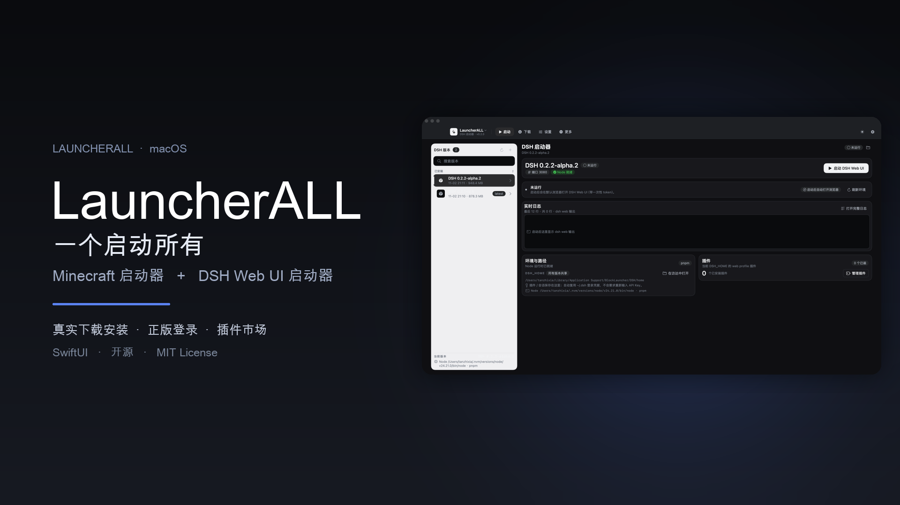

# LauncherALL · Minecraft 启动器（SwiftUI）

**LauncherALL** 是一个启动器集合：标题栏的品牌下拉菜单可在 **Minecraft 启动器** 与 **DSH 启动器** 之间切换，两者共用同一个壳、主题与窗口、相同的四个导航页。

- **Minecraft 启动器**：版本清单 / 安装 / Java 检测 / 正版登录 / 启动 / 日志 / 实例工具全部真实实现。
- **DSH 启动器**：管理官方 `@deepseek-ai/dsh` 的 **Web UI 实例**（从 npm 下载安装、同名/同版本可多开，每个实例独立名字与 `DSH_HOME`），一键启动 `dsh --profile web` 并在浏览器打开；「社区资源」换成 **DSH 插件市场**（加载源直接使用 dshmarket 的 `awesome-dsh-plugin.com/plugins.json`，8000+ 插件）；新增私有 **`.dshpack` 整合包**：把 DSH 本体 + 插件打成离线包，导入即成新实例。

用 **Swift 6 / SwiftUI** 写的 macOS Minecraft 启动器：**顶部导航（启动 / 下载 / 设置 / 更多）** + 极简平面化设计系统（一深一浅两套主题）+ 30 多个控件 + XML 声明式 UI 层。

**当前状态：不只是 UI 演示。** 启动链路（版本清单 → 安装 → Java 检测 → 启动 → 日志）走真实系统调用与网络；四个页面里的按钮、菜单、开关、滑杆、下拉、列表行都接真实行为或真实文件/网络操作，不再有"演示 / 假 sleep / 待接入"的占位交互。

## 宣传片

[](docs/promo/LauncherALL-promo.mp4)

一分钟看懂 LauncherALL：Minecraft 启动器 + DSH Web UI 启动器，共用一套壳与设计系统。

- 在线观看 / 下载：[docs/promo/LauncherALL-promo.mp4](docs/promo/LauncherALL-promo.mp4)（1080p，含中文旁白）
- 截图：[Minecraft 启动页](docs/promo/minecraft-launch.png) · [正版账户](docs/promo/minecraft-account.png) · [DSH 启动器](docs/promo/dsh-launcher.png) · [DSH 插件市场](docs/promo/dsh-plugin-market.png)

## 快速开始

```bash
# 直接运行（macOS 15+ / Xcode 26+ / Swift 6）
swift run MCLauncher

# 或用 Xcode 打开 SPM 包，跑 MCLauncher scheme
open Package.swift

# 离屏导出：启动器主界面（2 主题 × 4 导航页 × 2 窗口尺寸）
swift run MCLauncher --export-app-snapshots Snapshots/App

# 离屏导出：设计系统画廊（2 主题 × 9 页）
swift run MCLauncher --export-snapshots Snapshots
python3 tools/make_contact_sheet.py   # 需要 Pillow，生成对比图

# 测试（267 个用例，全部离线）
swift test
```

主界面顶部是四个导航页（⌘1~⌘4 切换）：

| 页面 | 内容 |
|---|---|
| **启动** | 实例列表 / 当前实例概览 / 启动与停止 / 实时启动日志 / 最近启动记录 |
| **下载** | Mojang 版本库 + 安装队列 / 安装选项 / 下载源 / 磁盘占用 / 社区资源（Modrinth） |
| **设置** | 启动 / Java / 性能 / 更新与语言 / 外观 / 账户（离线 + 正版登录）/ 关于 / 日志与诊断 |
| **更多** | 日志 / 实例备份 / 模组管理 / 截图相册 / 社区外链 / 快捷键 / 关于 / 快捷操作 |

### DSH 实例与整合包（`.dshpack`）

- **实例**：每次安装 DSH 都可以自定义名字（默认 `DSH <版本>`），同一个 npm 版本可以装多份；每个实例有独立的 `DSH_HOME`（插件 / 会话 / profile 互相隔离），登录凭据仍复用 `~/.dsh`，不会要求重新输入密钥。
- **整合包**：LauncherALL 私有格式 `.dshpack`（zip：`manifest.json` + 可选 DSH 本体 + 可选插件 tarball）。在「DSH → 下载 → 整合包」里导入 / 导出；启动页实例菜单也可以直接「导出为整合包」。导出可选「完整包（含 DSH 本体，离线可用，几百 MB）」或「轻量包（只记录版本，导入时从 npm 安装）」。
- 导入时自动创建新实例（可再自定义名字），插件装进该实例独立的 profile；导入失败 / 取消会自动回滚，不会留下半成品实例。

四个一级页面采用 PCL-CE 式「左面板 + 右内容」布局（布局参考 PCL2 社区版源码，控件与视觉全部用本项目 LauncherUI 实现，见 [docs/PCL-CE-REFACTOR.md](docs/PCL-CE-REFACTOR.md)）。设置页内部还有竖排分类导航；**最小窗口 1080×720 下各分区无需纵向滚动**。

顶栏右侧可一键切换深/浅主题；账户胶囊显示当前账户并进入「设置 → 账户」——在那里可以添加微软正版账户（浏览器输入验证码完成授权）、切换多账户或退出登录。

「更多 → 打开设计系统」或 ⌘⇧D 以 sheet 打开组件画廊与主题工作台。

## 交互一览（全部真实）

| 区域 | 交互 | 真实行为 |
|---|---|---|
| 全局 | ⌘1–⌘4 / ⌘⇧D / ⌘⇧T / ⌘R / ⌘, / ⌘↩ | 切页 / 设计系统 / 切换主题 / 刷新 Java 与实例 / 设置 / 启动选中实例 |
| 全局 | 轻提示、确认框、输入框、跨页跳转 | `LauncherRouter`：toast / dialog / prompt + pending 分区跳转（如"查看启动日志"→ 更多·日志） |
| 启动 | 启动 / 停止 / ⌘↩ | `Process` 真实启动游戏，stdout/stderr 实时进日志；停止真实 terminate |
| 启动 | 实例菜单 | 打开版本目录 / 在访达显示 / 打开 mods / 重命名 / 复制实例 / 校验文件 / 删除到废纸篓 / 复制启动命令 |
| 启动 | 账户胶囊 | 跳到设置·账户，管理离线玩家名与 UUID |
| 启动 | 最近启动 | 真实启动历史（版本 / 时间 / 时长 / 退出码），持久化到 UserDefaults |
| 标题栏 | 启动器切换 | LauncherALL 品牌下拉：Minecraft 启动器 / DSH 启动器；两个启动器共用导航，切换后四个页面换成对应产品的内容 |
| 启动 | 账户胶囊 | 显示当前账户（离线 / 正版）与类型徽标，点击进设置·账户 |
| 下载 | 安装 / 重新安装 | 真实下载版本 JSON、客户端 jar、依赖库、原生库、资源索引与资源对象（SHA1 校验） |
| 下载 | 安装选项 | `安装资源文件`（只装核心 or 全量）、`校验已存在文件`（重装时重新校验 SHA1）真实传给安装器 |
| 下载 | 安装队列 / 取消 | 串行队列，显示排队 / 安装 / 完成 / 失败 / 已取消，可取消当前或排队项、清理已完成项 |
| 下载 | 下载源 | 官方源 / BMCLAPI 镜像源，**真实改写**清单、版本 JSON、客户端、依赖库、资源文件 URL |
| 下载 | 版本详情 | 已安装版本同步读本地 JSON（Java 要求 / 资源索引），未安装版本异步拉官方 JSON |
| 下载 | 磁盘占用 / 清理缓存 | 后台真实统计 versions / libraries / assets / cache；清理缓存真实删除启动器缓存目录（需确认） |
| 下载 | 社区资源（Modrinth） | 六类真实搜索 / 排序 / 加载更多 / 详情；模组、资源包、光影、数据包下载到实例目录；世界 zip 解压到 `saves/` |
| 下载 | 整合包 | `.mrpack` 真实安装：基础版本 → Fabric/Quilt 加载器 → 新实例 → 清单文件（SHA1）→ overrides；本地 `.mrpack/.zip` 可导入 |
| 设置 | 游戏目录 / 版本隔离 | 目录选择器 + 真实目录预览；启动时按设置决定 `versions/<id>` 或根目录 |
| 设置 | Java 运行时 | 真实扫描 JDK + 手动路径探针（存在 / 可执行 / `java -version` 可解析）+ 自动选择 |
| 设置 | 性能 | 内存上限按物理内存计算、`-Xmx` 冲突提示、JVM 参数真实计数、渲染线程 |
| 设置 | 更新与语言 | 真实 HTTP 检查更新（可配置更新源，未配置时明确"未配置"）；旧版本清理真实删除；语言三语（见边界） |
| DSH | 启动 | DSH 实例列表（自定义名字 / 版本 / 整合包徽标，搜索 / 刷新 / 选择）、启动 / 停止 Web UI、端口与运行状态、实时日志、每实例 DSH_HOME、插件入口、导出整合包 |
| DSH | 下载 | 「DSH 版本」：npm 上 40 个 `@deepseek-ai/dsh` 版本的真实列表，安装时自定义实例名、同版本可重复安装，安装阶段 / 日志 / 取消，卸载确认；「插件市场」：按实例搜索 / 分类 / 排序 8000+ 插件、安装 / 卸载、已安装列表、加载源状态；「整合包」：导入 / 导出 `.dshpack`（完整包 / 轻量包）、本地整合包列表 |
| DSH | 设置 | Web UI 端口 / 自动打开浏览器 / 默认实例、npm registry、插件加载源（dshmarket 源）、缓存与数据目录、Node/pnpm 环境、每实例 DSH_HOME、危险区清理（删除所有实例数据） |
| DSH | 更多 | 运行日志（token 脱敏）、数据目录（versions / homes / cache / bin）、进程状态与打开 / 复制 / 停止、关于与快捷键 |
| 设置 | 账户（正版） | 微软设备码登录：大字验证码 + 复制 / 打开浏览器 + 倒计时 + 内联失败重试；多账户切换 / 刷新令牌 / 退出登录；启动时按选中账户使用正版身份 |
| 设置 | 账户（离线） | 玩家名校验（非法不写回）、已保存名切换 / 删除、离线 UUID 复制 |
| 设置 | 关于 / 日志 / 保存条 | 真实版本 / 构建号 / 构建时间 / git 提交；日志复制 / 导出 / 跳转；显示真实 `lastSavedAt`；恢复默认需确认 |
| 更多 | 日志与诊断 | 真实控制台 / 复制 / 诊断信息 / 清空确认 / 导出到 `~/Library/Logs/BlockLauncher/` 并在访达显示 |
| 更多 | 实例备份 | `ditto` 真实打包 saves / mods / config / options.txt / servers.dat 到 `backups/`；恢复（确认）/ 删除（废纸篓）/ 显示 |
| 更多 | 模组管理 | 真实扫描实例 `mods/`，启用 / 禁用即真实改名（`.jar` ↔ `.jar.disabled`），删除到废纸篓 |
| 更多 | 截图相册 | 真实扫描 `screenshots/`，受限解码缩略图，预览 / 访达 / 删除 / 复制路径 |
| 更多 | 快捷操作 / 快捷键 | 打开各类真实目录、导出日志、重置窗口布局（NSWindow）、只列真实注册的快捷键 |
| 更多 | 关于 / 收藏 | 真实构建信息与更新检查；工具收藏用 `@AppStorage` 持久化并置顶 |

## 设计取向

- **简约**：中性灰阶 + 单一强调色（深色主题近白、浅色主题近黑），状态色低饱和。
- **平面化**：没有毛玻璃、没有投影、没有渐变、没有发光；层级只由「分层底色 + 1px 边框」表达。
- **两套主题**：`graphite`（深色）/ `porcelain`（浅色），只换色不换结构。
- 详见 [`docs/DESIGN-SYSTEM.md`](docs/DESIGN-SYSTEM.md)。

## 目录结构

```
Sources/
  LauncherUI/                 # 设计系统 + 组件库 + 启动器界面
    Core/                     # 令牌、主题、排版、面板、动效、页面骨架
    Components/               # 按钮 / 输入 / 选择 / 容器 / 反馈 / 导航
    Launcher/                 # ★ 启动器主界面
      Backend/                # 真实后端：清单 / 安装 / 解析 / 启动 / Java
      Features/               # 交互能力：下载源、实例操作、构建信息、更新检查、窗口动作
        Auth/                 # 正版登录：微软设备码流 / Keychain 令牌 / 账户状态机 / 登录面板
        DSH/                  # DSH 启动器后端：版本目录 / 安装 / Web UI 进程 / 插件市场
        Download/             # Modrinth 客户端 + 安装中心（社区资源 / 整合包）
        Settings/             # 设置支持逻辑 + 分区视图 + 三语文案
        More/                 # 备份 / 模组 / 截图 / 日志导出服务
      Pages/                  # 启动 / 下载 / 设置 / 更多 四个页面
      LauncherRouter.swift    # 全局路由：toast / dialog / prompt / 跨页跳转
    Gallery/                  # 组件画廊 + 主题工作台 + XML 设计器
    Shell/                    # 画廊侧栏外壳
    XML/                      # XML UI 引擎（解析 / 状态 / 动作 / 渲染）
  MCLauncher/                 # 可执行 App 入口 + 各截图导出器 + CLI 工具
Tests/LauncherUITests/        # 267 个用例：后端 / XML / 四页交互 / 共享交互层 / 正版登录 / 产品切换 / DSH
docs/
  BACKEND.md                  # 真实后端与安装/启动链路
  APP-UI.md                   # 四页交互契约（控件 → 真实行为）
  XML-UI.md                   # XML UI 语言完整语法
  DESIGN-SYSTEM.md            # 设计系统说明（令牌 / 主题 / 规范 / 检查清单）
  API-CONTRACT.md             # 组件 API 契约
Snapshots/                    # 导出的主题 × 页面效果图 + 对比图（生成产物，已 gitignore）
tools/make_contact_sheet.py   # 生成主题对比图（Pillow）
```

## 效果预览

`Snapshots/App/` 下是 2 套主题 × 4 个导航页的离屏渲染图（1440×900 与最小窗口 1080×720 两套）；`Snapshots/sheet-app.png` 是四页对照图，`Snapshots/sheet-app-min.png` 是最小窗口免滚动验收图。

设计系统画廊：`Snapshots/` 下是 2 套主题 × 8 个页面的离屏渲染图，另附 `sheet-themes-demo.png`、`sheet-buttons.png`、`sheet-xml.png` 等对照图。

> 说明：截图由 `ImageRenderer` 离屏渲染。平面化后面板是真纯色，与真机一致；仅 AppKit 背书的控件（输入框、下拉菜单）在离屏模式下用同布局静态等价物渲染（`launcherSnapshotMode` 环境开关）。所有异步能力（磁盘统计、目录扫描、缩略图）在离屏模式下都走确定性静态值，不会出现"永远加载中"。

## 命令行工具

```bash
swift run MCLauncher --detect-java
swift run MCLauncher --auth-check                          # 验证正版登录端点可用（只申请设备码，不轮询）
swift run MCLauncher --dsh-check                            # 检查 DSH 环境/实例，真实启动一次 Web UI 后停止
swift run MCLauncher --dsh-install 0.2.1-rc.5 "工作版"      # 安装 DSH 实例（可自定义名字，同版本可多开）
swift run MCLauncher --dsh-pack-export 工作版 ~/工作版.dshpack  # 导出整合包（--runtime online 可导出轻量包）
swift run MCLauncher --dsh-pack-import ~/工作版.dshpack "副本"   # 导入整合包为独立实例
swift run MCLauncher --dsh-pack-inspect ~/工作版.dshpack         # 查看整合包 manifest
swift run MCLauncher --list-installed
swift run MCLauncher --launch-dry-run 1.21.11-Fabric    # 只打印最终命令，不启动
swift run MCLauncher --launch 26.3-Fabric --timeout 12  # 真实启动并收集日志
swift run MCLauncher --install 1.21.4                   # 真实下载安装
```

## XML UI 工具链

除了手写 SwiftUI，项目还提供一套 **XML → SwiftUI** 的声明式 UI 层：把控件封装成 XML 标签，运行时解析渲染，主题/间距/圆角完全复用同一套令牌。

```bash
# 1) 校验 XML（打印诊断，退出码 0 = 通过）
swift run MCLauncher --validate-xml Samples/XML/smoke.xml

# 2) 渲染成 PNG（设计评审 / CI 截图）
swift run MCLauncher --render-xml Samples/XML/smoke.xml out.png --theme porcelain --width 1200 --height 900

# 3) 导出全部内置示例 × 主题
swift run MCLauncher --export-xml-snapshots Snapshots/XML
```

能力概览：
- 布局：`vstack / hstack / zstack / scroll / grid / spacer / divider / panel / card / section / page / if / foreach`
- 基础：`text / label / mono / icon`
- 控件：`button / iconbutton / chip / badge / statusdot / textfield / searchfield / securefield / textarea / toggle / checkbox / radiocard / slider / stepper / segmented / dropdown`
- 容器与导航：`listrow / sectionheader / empty / avatar / keyvalue / stattip / progress / spinner / skeleton / banner / toast / sidebaritem / tabs / dialog`
- 状态与绑定：`<state>` 声明变量，`bind="name"` 双向绑定，`{state.x}` / `{item.y}` 插值，`onTap="动作名"` 或内置 `set:` / `toggle:` / `inc:` 简写。

完整语法与属性表见 [`docs/XML-UI.md`](docs/XML-UI.md)。

## 测试与验证

- `swift test`：**267 个用例**，全部离线（网络层用 `URLProtocol` stub / 认证服务注入替身）。
  - `LauncherBackendTests`（12）：规则求值、离线 UUID、参数替换、版本 JSON 兼容、版本扫描、命令构建
  - `AuthFeatureTests`（21）：设备码 / 刷新令牌 / XBL / XSTS / Minecraft 登录请求构造、响应解码、XSTS 错误码映射、会话刷新窗口、启动身份、登录状态机（成功 / 失败 / 取消 / 退出 / 令牌刷新）、正版启动参数注入与令牌脱敏
  - `XMLUITests`（16）：XML 解析 / 诊断 / 状态 / 插值 / 内置动作 / 渲染分发
  - `SharedInteractionsTests`（20）：镜像 URL 改写、版本比较、实例重命名/复制/删除、启动历史（含"已停止"状态）、账户名校验、启动参数清理、更新源解析、安装取消判定、父版本依赖保护、清理候选判龄
  - `DownloadFeatureTests`（35）：Modrinth URL/解码、安装路径决策、`.mrpack` 解析与缺下载地址、zip-slip 条目校验、loader 兼容判断、离线安装流程
  - `SettingsFeatureTests`（30）：内存方案、JVM 冲突、Java 探针、清理规划、日志导出（与更多页同落点）、三语文案完整性与文案真实性
  - `MoreFeatureTests`（18）：真实临时目录下的 ditto 备份/恢复、模组启停、截图缩略图、日志导出、备份暂存清理
  - `DSHBackendTests`：DSH 版本 semver 比较、npm 版本目录解码、插件加载源解析与安装标识、实例目录 / 每实例 home、安装扫描 / 卸载 / 迁移、已安装插件读取、端口、命令执行、pnpm shim、token 脱敏
  - `DSHPackTests`（27）：`.dshpack` manifest 编解码、bundled 导出 / 导入、online 导出、离线插件载荷持久化/再导出、导入失败与取消回滚、online guard、symlink 拒绝、原子导出、非法包与路径校验、同版本多实例
  - `DSHDownloadUITests`（27）：实例命名安装 / 同版本多实例、整合包导入导出与进度/门禁、插件格式化与分区排序、dist-tag、深链、快照三分类渲染
  - `DSHLaunchUITests`（14）：实例列表 / 运行态按实例 ID、整合包徽标与导出菜单、日志/状态/脱敏、两主题离屏渲染
  - `DSHSettingsUITests`（20）：实例化设置、每实例 DSH_HOME、统计与删除数据、快照安全、校验/格式化
  - `DSHMoreUITests`（3）：实例日志映射、同版本多实例、四分区两主题离屏渲染
  - `ProductSwitcherTests`（4）：LauncherALL 产品元数据、Minecraft/DSH 切换、跨产品切页、DSH 启动页两主题离屏渲染
- `swift run MCLauncher --export-app-snapshots …`：**32 张**（2 主题 × 2 启动器 × 4 页 × 2 尺寸）全量渲染验收。
- 启动页实机验证：`--launch` 可加载 Fabric Loader 与玩家模组（见 [docs/BACKEND.md](docs/BACKEND.md)）。

## 已知边界

- 正版登录使用微软 OAuth 设备码流（`consumers` 租户），需要浏览器完成授权；默认复用 PCL.Swift 的公开客户端 ID，正式发布建议在 Azure 自建应用并替换 `MicrosoftAuthEndpoints.defaultClientID`。
- 正版令牌存 Keychain（不可用时回退到 `~/Library/Application Support/BlockLauncher/auth/` 下 0600 权限 JSON）；启动前会在令牌临近过期时自动刷新，刷新失败会中止启动并提示重新登录（不会静默降级成离线）。
- 正版头像（顶栏账户胶囊 / 设置账户行 / 登录成功）使用 crafatar 作为展示兜底（官方 textures 接口需要额外解析），仅影响界面展示，不影响启动身份；暂未做皮肤管理 / 披风切换。
- 未接入 401 自动重试、多设备登录管理与企业租户（仅个人微软账户）。
- DSH 启动器管理的是官方 `@deepseek-ai/dsh` 的 **Web UI 版本**：每个版本 ~850 MB（含依赖），安装需要 Node 20+ 与 pnpm/npm（优先系统 Node，其次 DSH 桌面端自带运行时）；启动后 Web UI 在默认浏览器打开，不内嵌到启动器。
- DSH 的每个实例有独立 `DSH_HOME`（`~/Library/Application Support/BlockLauncher/DSH/homes/<实例 UUID>`），首次启动会把 `~/.dsh/.credentials.yaml` 等凭据软链进来复用登录 / API Key；插件、会话与系统 DSH 的 web profile 分开，旧版共享 home 会自动迁移。
- 很旧的实验版本（例如 `0.0.1-rc.1`）的部分依赖已从 npm 下架，无法安装；安装前会用 pnpm 做依赖预检（约 5–30 秒），遇到 404 会直接提示「该版本依赖已不可用」，不会长时间卡在「准备安装环境」。
- `.dshpack` 是 LauncherALL 私有格式（不是 dsh 官方格式）：`bundled` 包含 DSH 本体（压缩后几百 MB，离线可用），`online` 只记录版本号（导入时需要网络）；插件可附带 npm tarball 离线载荷，没有载荷的插件会在线安装。
- 插件安装需要 pnpm：优先系统 pnpm，否则用 DSH 桌面端自带的 pnpm 生成 shim；没有 Node/pnpm 时 UI 会给出明确提示而不是假装成功。
- 仅 macOS（osx / arm64、x86_64）规则；Windows / Linux 需要补规则与路径。
- 整合包只支持 Fabric / Quilt / 原版；Forge / NeoForge 整合包会给出明确错误，不做假成功。加载器元数据直连 Fabric/Quilt 官方域，不走 BMCLAPI 镜像。
- 镜像源只改写 Mojang 域名；Fabric / Quilt / Modrinth 域名直连。
- 语言切换当前覆盖「设置」页文案（zh-Hans / en / ja，259 个键）并即时生效；其余页面文案仍为中文，界面会如实说明，不做"全界面已切换"的承诺。
- 未实现模组更新检测 / 冲突分析、资源包与光影的深度管理；备份默认只含 saves / mods / config / options.txt / servers.dat。
- 首次安装资源文件数量多、耗时较长；已存在文件默认跳过，可在安装选项里要求校验。

## 加一套主题

见 [`docs/DESIGN-SYSTEM.md`](docs/DESIGN-SYSTEM.md) 第 3 节：工厂方法声明 → 加入 `LauncherThemes.all` → 全站自动适配。

## 加一个组件

1. 只用 `theme.colors.*` / `.textStyle(...)` / `LauncherSpace` / `LauncherRadius` / `GlassPanel`，禁止投影、模糊、渐变；
2. Public init 写进 `docs/API-CONTRACT.md`；
3. 在对应 Gallery 页加一组状态展示（默认 / 选中 / 禁用 / 加载 / 错误）。
